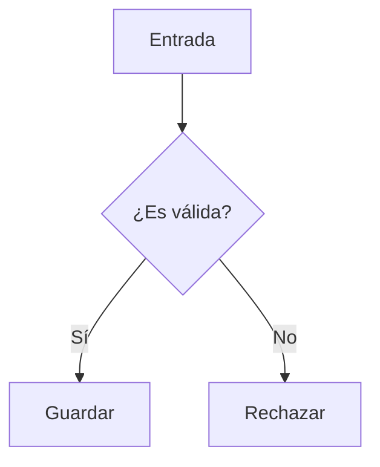

# Study view: content, not page design

> A part's main page is now its rich HTML page written with the kit (`docs/kit.md`):
> the complete explanation with richer visuals, inline demos, the connected quiz and
> the video button. This Markdown guide still governs the `.md` note the vault and the
> engine keep, and quick notes.

Builders write Markdown and learning material only. The shared view supplies the
Distill Academic layout from the rendered videos: white paper, DejaVu Sans body
and bold headings, DejaVu Sans Mono code and table cells, restrained semantic
accents, a single centered column, numbered sections, tables, callouts and diagrams.
The view derives a small uppercase part kicker from `# Parte N — Title`; a trailing
parenthesized subject becomes its short label (e.g. `PARTE 3 · WHERE`).
Do not plan or build a separate page for each part. Planning and maps stay in
Markdown notes; they do not need custom HTML pages.

## Structure a part (Pure Method)

Start with a one-sentence formal definition, then the part title and video.
Use numbered level-two headings such as `## 1. Por qué existe`; the view separates
the section number automatically. Keep one concrete example running throughout.

1. Explain the practical problem: what fails without this concept?
2. Break down the pieces using everyday questions.
3. Walk through discrete steps; write list items starting with `T0`, `T1`, `T2`.
4. Move from intuition to a decision table to the formal rule or function.
   Show calculations and validations line by line.
5. State critical distinctions directly, e.g. `Una fila ≠ una tabla` in its own
   paragraph. Include an explicit “Dónde se rompe la analogía” section.
6. Include a binary decision tree: “El mapa mental más importante”.
7. Close with `Entrada ➔ Proceso ➔ Salida` in its own paragraph, a table with one
   line per concept, and three takeaway bullets.
8. Include a quick-quiz checkpoint in every explanatory point (`> [!question] Quiz rápido — Punto N` or `<lk-quick-quiz>`), evaluating the immediate concept with options A–E and recording telemetry (right/wrong, why, and adaptive category across any topic: sciences, medicine, languages, humanities, finance, code).
### The answers belong to the quiz they answer

`mini-quiz/<part>.answers.json` records the learner's choices **and a fingerprint of the
quiz they answered** — its question ids, statements, every option with its letter **and the
letter the tutor keyed**, in canonical order. The keyed letter is the point: a quiz re-keyed
in place keeps every word and changes only which option is right, and answers for the old key
must not be scored against the new one. The bridge only treats those answers as «already
answered» when the fingerprint matches the quiz on disk: a part whose quiz was regenerated
(a regeneration archives the answers with the old quiz) or a file written before the
fingerprint existed is **stale**, and the reader shows the form again instead of a dead
«0/0». Submitting then replaces the stale file in place; nothing is deleted, and the old
answers stay readable in `.papelera` when they travelled with a regeneration. The same
rule hides the practical exercises' solutions until the learner answers this quiz.

The engine holds the same rule from its own side (`internal/engine`): `quizFingerprint` is
implemented twice — here and in the bridge — and a shared golden value in both test suites is
what keeps them from drifting apart. An answers file that names no quiz, or another one, is
**not graded**: the quiz stage reports `waiting for learner input` instead of deriving a score.
That is also how a vault written before this rule recovers — the learner answers that quiz once
more, and the new answers name it.

9. Supply the required final mini-quiz (five A–E questions, E = “No sé”) and two practical
   exercises (Easy and Medium). The tutor supplies the quiz JSON sidecar; the view
   renders the answer/reasoning controls. Do not hand-build a quiz form.

## Markdown components

```markdown
## 2. Cómo funciona

- T0: Estado inicial.
- T1: Aparece una fila. ◄── NUEVO
- T2: La restricción impide guardarla. ◄── BLOQUEO

> [!note] Regla
> Una idea breve, con **énfasis** o `código`.

> [!warning] Límite
> Describe cuándo deja de funcionar.

> [!success]- Comprobar después
> Contenido plegado inicialmente.
```

Callouts use `> [!type] Title`: `note`, `info`, `video` use cobalt;
`tip`, `success`, `check` use emerald; `warning`, `caution`, `attention` use amber;
`danger`, `failure`, `bug`, `error` use crimson. Labels carry meaning as well as
color. Add `-` for collapsed details or `+` for initially expanded details.

Use normal Markdown tables with a header row for decisions and comparisons.
Markdown notes use fenced code blocks with a language (e.g. `sql`); no screenshots of code.
In a rich HTML page, write code as `<pre><code class="language-sql">…</code></pre>`;
escape `<`, `>` and `&` in the code as `&lt;`, `&gt;` and `&amp;`. Never put
Markdown fences in HTML pages: `explain-check` rejects them and cites their line.
Keep tables and code short; wide content scrolls rather than shrinking text.
Markers are highlighted in prose, not inside literal code blocks.

Use fenced `mermaid` diagrams, vertically (`flowchart TD` or `direction TB`),
with short labels and preferably under 400px wide. The view centers diagrams
and provides white boxes, fine borders and sans-serif labels:

````markdown

````

SVG diagrams can be inline `<svg>…</svg>` or enclosed in a fenced `svg` block.
The reader renders both through the same sanitizer: event handlers, external
images, `use` and `foreignObject` are not allowed. Use a `text` or `html` fence
when showing SVG source as a code example instead of drawing it.

## Video and optional interactive demos

Store videos under `explicaciones/adjuntos/` and embed by filename:

```markdown
> [!video] Explicación en video
> ![[Parte N - slug.mp4]]
```

Only genuinely interactive experiments need standalone demo HTML, named
`explicaciones/demos/<part>-<name>.html` (e.g. `p3-filtro.html`). The bridge
discovers them; do not insert iframes into the note. Demos run in sandboxed
iframes with scripts allowed, without same-origin access. To send an observation
to the question box:

```js
parent.postMessage({ type: "learning-demo", observation: "El filtro excluyó dos filas." }, "*");
```

The parent checks the sending iframe and payload type. Observations (prefixed
with the demo filename, capped at 2,000 characters) populate the question box;
the learner still submits them to the tutor. Do not send secrets or answers
through this channel.

### Demo frame and page rules

The reader frames a demo to its content (#338). The bridge adds a small reporter,
`integrations/pi/kit/demo-height.js`, inside the `<head>` of every demo page it serves.
The reporter posts `{ type: "learning-demo-height", height }` with the content's height,
and the frame takes it, between 320 and 900 px. Above 900 px the demo scrolls inside its
frame. A demo that never reports keeps the default frame: 420 px, or 360 px on a phone.
The reader asks for a new measure when the frame's width changes, because a narrower or
wider screen rewraps the text. A saved part carries the same reporter.

A demo page must:

- have one scroller, its frame. Do not nest a scroll container (`overflow: auto` with a
  fixed height or a `max-height`, a card that scrolls) inside the page.
- not set `height: 100%`, `100vh` or `min-height: 100vh` on `html` or `body`. The frame
  takes the content's height, so a page that fills the viewport has no height to report.
- keep text at 14 px or more, and body text at 16 px or more.
- wrap long code lines (`white-space: pre-wrap` with `overflow-wrap: anywhere`). A line
  that truly cannot wrap may scroll sideways inside its own block, never by pushing the page.
- keep its content in the normal flow: content positioned outside it is not measured.

## The video control belongs to every node

The video is not optional furniture: every part node must offer a way to get it, and the
reader adds it automatically. When `explicaciones/adjuntos/Parte N - <slug>.mp4` exists it
renders the player; otherwise it shows **«🎬 Generar video»**, which posts
`{kind: "video", topic, part}` to the chat and polls the file until it appears. A rich page
keeps the same guarantee through `<lk-video></lk-video>`; the bridge injects the component
(and `kit.js`/`kit.css`) when the page forgot it. Do not hard-code a second player, a custom
button or a page-specific script.

## Checkpoints in the middle of a node

A rich page can quiz inside a section with `lk-checkpoint`. It takes an inline JSON array,
gives immediate local feedback and never calls the engine, so it fits after a formula or a
distinction the learner must apply before moving on. The graded five-question `lk-quiz`
still closes the part; checkpoints are ungraded self-checks.

```html
<lk-checkpoint>
[
  {"q": "¿Qué devuelve evaluar la política en un estado?",
   "options": ["Una acción", "El valor esperado de seguirla", "La recompensa inmediata"],
   "answer": 1,
   "why": "La evaluación de política estima v(s): lo que se espera ganar siguiéndola desde ahí."}
]
</lk-checkpoint>
```

Keep one to three questions per checkpoint, plausible distractors and a one-sentence
`why`. Do not repeat the mini-quiz questions; a checkpoint checks the step just read.

## Do not

- Design a per-part page, stylesheet, hero, dashboard or navigation shell.
- Add inline HTML styling, scripts, event handlers, remote fonts or dependencies.
- Draw ASCII boxes/arrows or horizontal diagram flows; use vertical Mermaid.
- Use dark backgrounds, gradients, decorative animation or color-only meaning.
- Duplicate the view’s quiz, verdicts, results, reward banner or tutor controls.
