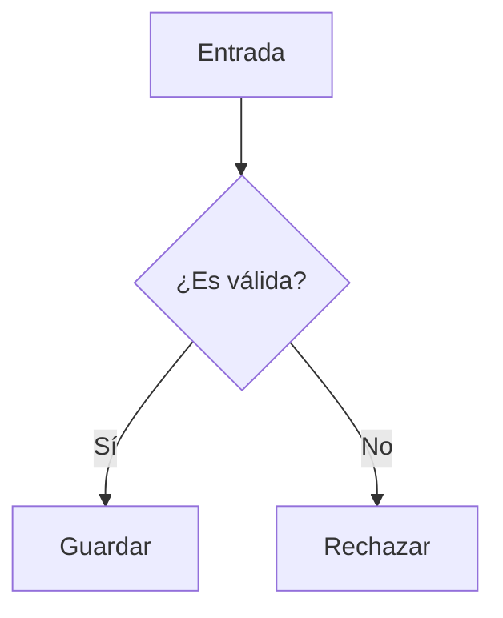

# Study view: content, not page design

> A part's main page is now its rich HTML page written with the kit (`docs/kit.md`):
> the complete explanation with richer visuals, inline demos, the connected quiz and
> the video button. This Markdown guide still governs the `.md` note the vault and the
> engine keep, and quick notes.

Builders write Markdown and learning material only. The shared view supplies the
Distill Academic layout from the rendered videos: white paper, DejaVu Sans body
and bold headings, DejaVu Sans Mono code and table cells, restrained semantic
accents, a single centered column, numbered sections, tables, callouts and diagrams.
The view derives a small uppercase part kicker from `# Parte N — Title`; a trailing
parenthesized subject becomes its short label (e.g. `PARTE 3 · WHERE`).
Do not plan or build a separate page for each part. Planning and maps stay in
Markdown notes; they do not need custom HTML pages.

## Structure a part (Pure Method)

Start with a one-sentence formal definition, then the part title and video.
Use numbered level-two headings such as `## 1. Por qué existe`; the view separates
the section number automatically. Keep one concrete example running throughout.

1. Explain the practical problem: what fails without this concept?
2. Break down the pieces using everyday questions.
3. Walk through discrete steps; write list items starting with `T0`, `T1`, `T2`.
4. Move from intuition to a decision table to the formal rule or function.
   Show calculations and validations line by line.
5. State critical distinctions directly, e.g. `Una fila ≠ una tabla` in its own
   paragraph. Include an explicit “Dónde se rompe la analogía” section.
6. Include a binary decision tree: “El mapa mental más importante”.
7. Close with `Entrada ➔ Proceso ➔ Salida` in its own paragraph, a table with one
   line per concept, and three takeaway bullets.
8. Supply the required mini-quiz (five A–E questions, E = “No sé”) and two practical
   exercises (Easy and Medium). The tutor supplies the quiz JSON sidecar; the view
   renders the answer/reasoning controls. Do not hand-build a quiz form.

## Markdown components

```markdown
## 2. Cómo funciona

- T0: Estado inicial.
- T1: Aparece una fila. ◄── NUEVO
- T2: La restricción impide guardarla. ◄── BLOQUEO

> [!note] Regla
> Una idea breve, con **énfasis** o `código`.

> [!warning] Límite
> Describe cuándo deja de funcionar.

> [!success]- Comprobar después
> Contenido plegado inicialmente.
```

Callouts use `> [!type] Title`: `note`, `info`, `video` use cobalt;
`tip`, `success`, `check` use emerald; `warning`, `caution`, `attention` use amber;
`danger`, `failure`, `bug`, `error` use crimson. Labels carry meaning as well as
color. Add `-` for collapsed details or `+` for initially expanded details.

Use normal Markdown tables with a header row for decisions and comparisons.
Use fenced code blocks with a language (e.g. `sql`); no screenshots of code.
Keep tables and code short; wide content scrolls rather than shrinking text.
Markers are highlighted in prose, not inside literal code blocks.

Use fenced `mermaid` diagrams, vertically (`flowchart TD` or `direction TB`),
with short labels and preferably under 400px wide. The view centers diagrams
and provides white boxes, fine borders and sans-serif labels:

````markdown

````

## Video and optional interactive demos

Store videos under `explicaciones/adjuntos/` and embed by filename:

```markdown
> [!video] Explicación en video
> ![[Parte N - slug.mp4]]
```

Only genuinely interactive experiments need standalone demo HTML, named
`explicaciones/demos/<part>-<name>.html` (e.g. `p3-filtro.html`). The bridge
discovers them; do not insert iframes into the note. Demos run in sandboxed
iframes with scripts allowed, without same-origin access. To send an observation
to the question box:

```js
parent.postMessage({ type: "learning-demo", observation: "El filtro excluyó dos filas." }, "*");
```

The parent checks the sending iframe and payload type. Observations (prefixed
with the demo filename, capped at 2,000 characters) populate the question box;
the learner still submits them to the tutor. Do not send secrets or answers
through this channel.

## The part's interactive app

When the explanation itself should be an experiment (predict, act, compute, check),
write it as one self-contained page, `explicaciones/apps/<part>.html` (inline CSS and
JS, no network). `learning_view` then returns an **Aplicación interactiva** URL and the
part page shows a launch button. The bridge serves the app full page and injects
`window.LEARNING_BRIDGE = { submitUrl, topic, part }` (plus `transcribeUrl` when configured)
and the shared dictation helpers. An app that asks quiz questions renders each reasoning
field with `window.learningThoughtField(questionId, index, window.LEARNING_BRIDGE)`:
one optional «Cómo lo pensé» field with «Dictar», never the old two fields
«¿Qué entendiste…» / «¿Por qué llegaste…». It sends
`reasoning[id] = { razonamiento, confianza }` alongside `answers` in the same fixed
payload as the view (`kind: "mini-quiz"`; `kind: "question"` with `text` for questions).
The bridge grades
the quiz, so the app holds no answer keys; keep question ids and option letters equal
to `mini-quiz/<part>.json`. Opened without the bridge (`window.LEARNING_BRIDGE`
undefined) the app must still run its experiments and say it is not connected.
Reference: the reinforcement-learning Part 3 test app
(`Learnings/prueba-vista-aprendizaje-por-refuerzo/explicaciones/apps/p3.html`).

## Do not

- Design a per-part page, stylesheet, hero, dashboard or navigation shell.
- Add inline HTML styling, scripts, event handlers, remote fonts or dependencies.
- Draw ASCII boxes/arrows or horizontal diagram flows; use vertical Mermaid.
- Use dark backgrounds, gradients, decorative animation or color-only meaning.
- Duplicate the view’s quiz, verdicts, results, reward banner or tutor controls.
