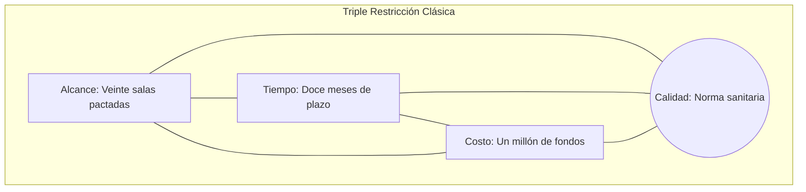

# Parte 3 — Restricciones y Presupuesto: Triple Restricción y Gestión de Reservas

**Fuente**: Project Management Institute (2021). Guía del PMBOK (7ma edición).

Dirigir un proyecto exige vigilar con cuidado todos los acuerdos firmados.
Los líderes cuidan siempre los fondos disponibles y las fechas de entrega.

Planificar las obras del centro requiere ordenar los gastos con anticipación.
Frente a los problemas, el equipo separa sus fondos de auxilio.

Esta parte enseña a equilibrar límites operativos y reservas de dinero.
Aprenderás a responder con rapidez y orden ante cualquier gasto imprevisto.

## Ruta

1. Tres límites — Aquí verás cómo las tareas, el plazo y los fondos guían la obra.
2. Fondos de reserva — Aquí verás cómo el director cubre riesgos conocidos con dinero oficial.
3. Fondos de crisis — Aquí verás cómo la dirección cubre imprevistos mayores fuera de la base.

## El 20% que rinde el 80%: La triple restricción clásica en la dirección de proyectos

En nuestro ejemplo, el hospital avanza sus obras.
El equipo cuida los fondos asignados.

La meta es clara.
El trabajo no para.

**Triple restricción clásica**: es el equilibrio entre metas.
Abarca el alcance, el tiempo y el costo.

**Alcance**: es el trabajo pactado.
En nuestro ejemplo, fija veinte salas.

**Tiempo**: es el plazo límite.
En nuestro ejemplo, fija doce meses.

**Costo**: es el dinero asignado.
En nuestro ejemplo, fija un millón.

La calidad depende de este equilibrio.
Sin embargo, no es un vértice.

Frente a la rigidez, hay balance.
A diferencia de prometer sin fondos, hay control.

Si el alcance sube, el costo sube.
En cambio, acortar plazos exige fondos.

El control es total.

Cómo leerlo: los tres vértices equilibran la obra; si uno cambia, los otros se ajustan.

## Estructura presupuestaria: Línea base, reserva de contingencia y reserva de gestión

El hospital organiza sus fondos con orden.
Cada fondo tiene un fin claro.

El dinero está seguro.
La cuenta es exacta.

**Reserva de contingencia**: es el fondo para riesgos conocidos.
En nuestro ejemplo, cubre lluvias de invierno.

**Línea base de costo**: es el presupuesto oficial aprobado.
El director la aprueba directamente.

Frente al gasto ciego, hay orden.
A diferencia de ocultar fallos, hay reservas.

**Reserva de gestión**: es el fondo para imprevistos mayores.
En nuestro ejemplo, cubre catástrofes no previstas.

Esta reserva queda fuera de la base.
Solo la alta dirección autoriza su uso.

En vez de frenar, hay respaldo.
Por el contrario, gastar sin permiso quiebra normas.

Sumar la base y la gestión da el total.
El plan queda firme.

<lk-guided>

</lk-guided>

Cómo leerlo: la contingencia entra en la base; la gestión se suma al total.

## Mini-quiz

Las preguntas de esta parte viven en su `mini-quiz/p3.json`: el lector las dibuja como el lk-quiz interactivo.

### q1: ¿Qué variables componen la triple restricción clásica de un proyecto?

### q2: ¿Qué reserva cubre las lluvias estacionales y en qué nivel se ubica?

### q3: ¿Quién autoriza la reserva de gestión ante una crisis imprevista?
